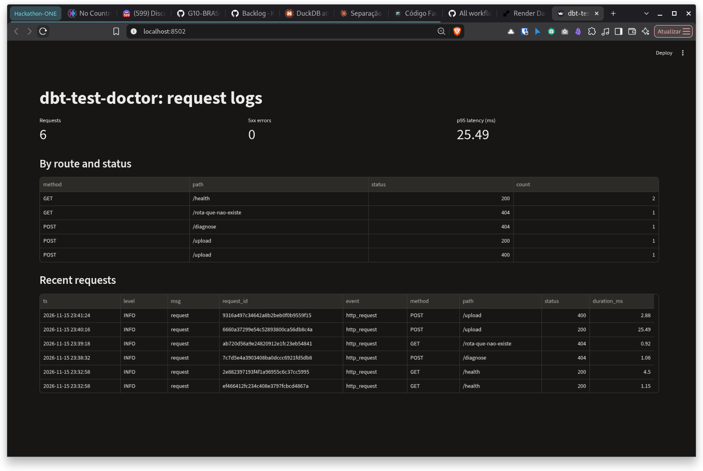

# dbt-test-doctor

## Problem
When `dbt test` fails, the output lists SQL-level failures, and engineers have to open
compiled SQL to find the cause. dbt-test-doctor reads the dbt `run_results.json` file,
lists every failing or erroring test, classifies it (not_null, unique, relationships,
accepted_values, other) and suggests a fix.

## How to run
```bash
docker compose up --build
```
Open http://localhost:8001 and upload `tests/fixtures/run_results.json`.

## Run tests
```bash
uv venv
uv pip install -r requirements.txt
uv run pytest
```
The suite has 10 tests: unit tests for the diagnosis logic and integration tests for the API.

## Logging
Each HTTP request writes one JSON line to stdout, with a `request_id` that is also returned
in the `X-Request-ID` response header. A valid `X-Request-ID` sent by the client is reused.
Logs never contain request bodies, query strings, headers, or the content of uploaded
`run_results.json` files. Set `LOG_PATH` to also write the logs to a file.

## Observability
Each request writes one structured JSON log line with a `request_id`. The optional
dashboard in `dashboard/` reads these lines with DuckDB and shows them in Streamlit:
request counts per route and status, 5xx errors, and p95 latency.

Run the API with logging enabled, then the dashboard:

```bash
LOG_PATH=logs/app.jsonl uv run uvicorn app.main:app --port 8001
VIRTUAL_ENV=.venv-dashboard uv run streamlit run dashboard/app.py
```

The dashboard has its own environment (`requirements-dashboard.txt`), so Streamlit
does not conflict with the API dependencies. Open http://localhost:8501.



## Live deployment
- **URL:** https://dbt-test-doctor.onrender.com
- **Health check:** https://dbt-test-doctor.onrender.com/health

## Deployment notes
The app runs on Render's free tier. Render sets the `PORT` variable, and the container
reads it at startup (`${PORT:-8000}` in the `Dockerfile`).

The free tier has no persistent disk, so the SQLite database (`DB_PATH`) and any log file
are ephemeral: data is lost on every new deploy or restart. Persistent storage would
require a paid plan with a disk or an external database.

Free instances spin down after about 15 minutes without traffic. The first request after
that can take around 50 seconds.

## Alerting
An external UptimeRobot monitor checks `/health` every 5 minutes. It sends an email alert
when the service goes down and another when it recovers. This confirms the application
responds; it does not cover failures inside the database layer.

## Specification
See `docs/SPEC.md`. Agent workflow: `docs/PROCESS.md`. Agent rules: `AGENTS.md`.
